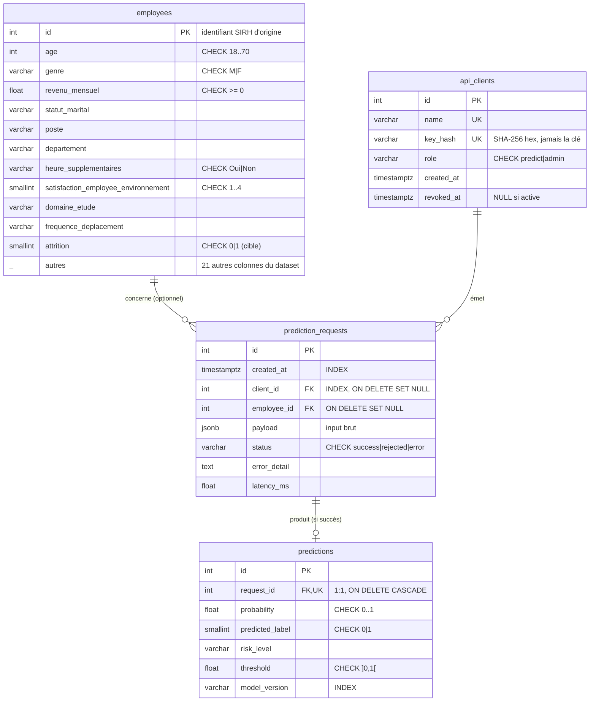

# Modèle de données — base `technova_attrition` (PostgreSQL 16)

Défini dans `app/models/database.py` (SQLAlchemy 2), créé par `scripts/create_db.py`.

## Objectifs de conception

1. **Traçabilité complète** : toute requête sur `/predict` est enregistrée, avec son input exact, son appelant, son issue (succès, rejet de validation, erreur) et, en cas de succès, la prédiction et **la version du modèle** qui l'a produite.
2. **Intégrité garantie par le SGBD** : clés étrangères, `CHECK`, `UNIQUE`, `NOT NULL`. Une donnée incohérente est refusée par la base même si l'application a un bug.
3. **Normalisation (3NF)** : chaque fait est stocké une fois. Seule exception volontaire : le payload brut en `JSONB`, archive fidèle de l'input pour l'audit.
4. **Volume** : index sur les colonnes de filtrage temporel et de jointure ; tables de logs partitionnables par date.

## Diagramme entité-association



## Tables

### `employees` — dataset de référence

1 470 lignes, issues de la jointure 1:1 des trois extraits (SIRH, évaluations, sondage) sur l'identifiant employé (`eval_number = "E_<id>"`, `code_sondage = <id>`). La clé primaire est **l'identifiant SIRH d'origine** : on peut relier une prédiction à la source RH. Insertion par `scripts/insert_dataset.py` en une transaction.

Elle sert à : prédire pour un employé connu (`POST /predict/employees/{id}`) ; mesurer la performance réelle en joignant les prédictions aux issues observées (`attrition`) ; servir de distribution de référence pour la détection de dérive.

### `api_clients` — contrôle d'accès

| Colonne | Contrainte | Rôle |
|---|---|---|
| `key_hash` | `UNIQUE NOT NULL` | Empreinte SHA-256 de la clé (256 bits aléatoires) ; l'authentification compare des empreintes |
| `role` | `CHECK IN ('predict','admin')` | `admin` seul accède à l'historique (données personnelles) |
| `revoked_at` | nullable | Révocation sans suppression : l'historique des requêtes du client reste intact |

### `prediction_requests` — journal de toutes les requêtes

| Colonne | Contrainte | Rôle |
|---|---|---|
| `payload` | `JSONB NOT NULL` | Input exact reçu (y compris invalide) |
| `status` | `CHECK IN ('success','rejected','error')` | `rejected` = 422 (validation), `error` = 500 (échec du modèle) |
| `client_id` | FK → `api_clients`, `SET NULL` | Qui a appelé ; `NULL` si la requête a été rejetée avant authentification |
| `employee_id` | FK → `employees`, `SET NULL` | Employé concerné, s'il est connu |
| `latency_ms` | — | Suivi de performance |

### `predictions` — sorties du modèle

Relation **1:1** avec `prediction_requests` (`request_id UNIQUE`) : une requête réussie produit exactement une prédiction ; une requête rejetée ou en erreur n'en produit aucune. On sépare les deux tables pour ne pas avoir de colonnes de prédiction toujours `NULL` dans les requêtes en échec. `threshold` et `model_version` sont stockés **avec chaque prédiction** : la décision reste explicable même après un changement de modèle ou de seuil.

## Index et volumétrie

| Index | Requêtes servies |
|---|---|
| `ix_prediction_requests_created_at` | Historique récent, agrégats par jour ou semaine (tableau de bord) |
| `ix_prediction_requests_client_id` | Activité par client (les FK ne sont pas indexées automatiquement par PostgreSQL) |
| `ix_predictions_model_version` | Comparaison de versions (champion / challenger, suivi après déploiement) |
| `predictions_request_id_key` (UNIQUE) | Jointure requête ↔ prédiction |

Index B-tree : recherche en O(log n). À fort volume : partitionnement par mois de `prediction_requests` (`PARTITION BY RANGE (created_at)`), purge ou archivage au-delà de la durée de conservation fixée (RGPD).

## Transactions

Une requête HTTP = une session = une transaction (`app/db/session.py`) : la requête et sa prédiction sont validées ensemble, ou annulées ensemble. Les requêtes en erreur sont validées explicitement avant de renvoyer le 500, pour que l'échec reste tracé.

## Exemples d'entrées

```sql
SELECT r.id, r.created_at, r.status, c.name AS client, r.employee_id,
       p.probability, p.predicted_label, p.risk_level, p.model_version
FROM prediction_requests r
LEFT JOIN api_clients c ON c.id = r.client_id
LEFT JOIN predictions p ON p.request_id = r.id
ORDER BY r.created_at DESC LIMIT 5;
```

| id | status | client | employee_id | probability | predicted_label | risk_level | model_version |
|---|---|---|---|---|---|---|---|
| 2 | rejected | e2e | — | — | — | — | — |
| 1 | success | e2e | 1 | 0.9165 | 1 | critique | logreg-75ca1bf21884 |
